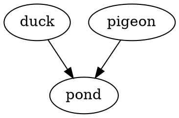

Kroki draws each diagram fence with its tool: PlantUML, Graphviz, D2, DBML, GoAT, or Svgbob. When the tool can't read the source, Kroki answers with its error, and the fence stays as code. The message gives the first lines of that error, which usually name the line to fix.

A diagram that failed is sent again on the next parse, so fix the source and build again:

````md

````

It has no example to lint here, since only Kroki can tell, and linting sends no diagram to it.
