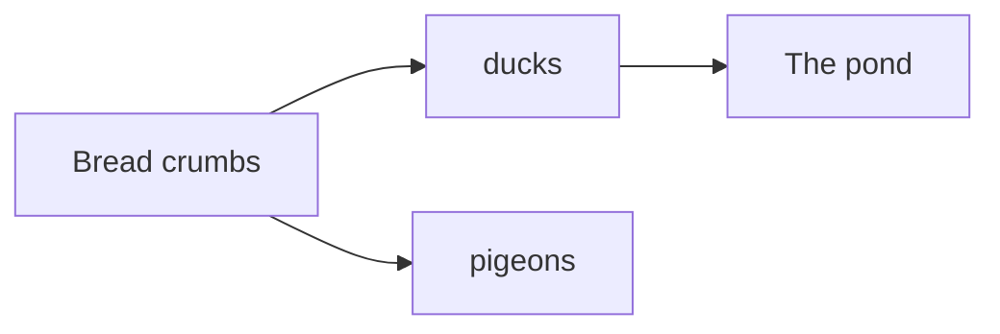
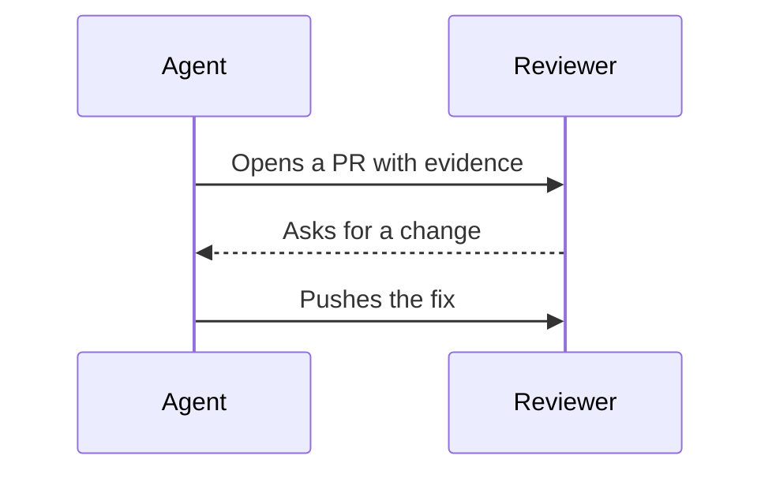
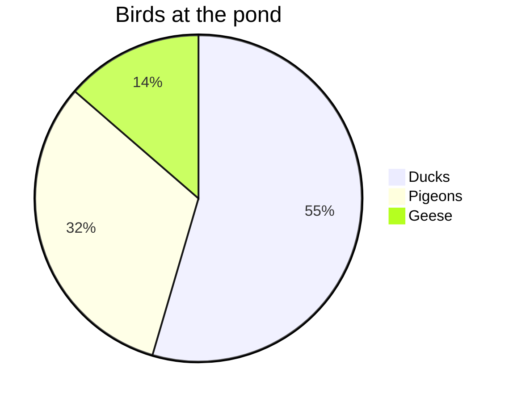
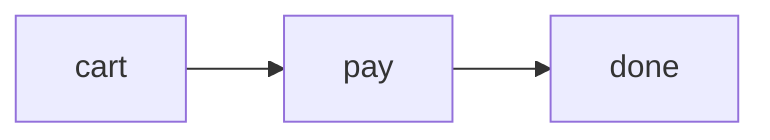

::examples
:::example{label="Flowchart"}
````md

````
:::

:::example{label="Sequence"}
````md

````
:::

:::example{label="Pie"}
````md

````
:::
::

## Features

- Agents already write Mermaid and GitHub renders it. A diagram shows a flow or a schema faster than prose.
- [comark-pele](https://github.com/farnabaz/comark-pele) turns each `mermaid` fence into SVG with [Pele](https://pele.run), a Mermaid renderer with no dependencies.
- The diagram reads with no script, and its source never leaves your machine.
- Through comark-ui, Copy image and Copy source copy a diagram as a PNG or as its Markdown. With `comark-ui/html`, a click, `Enter`, or `Space` zooms it.
- Through comark-ui, diagrams follow the [shared tokens](/guide/theming/) in light and dark.
- comark-pele is a third-party plugin by [farnabaz](https://github.com/farnabaz). [comark-ui](/getting-started/) registers it for you.

## Usage

Write a diagram in a ` ```mermaid ` or ` ```pele ` fence. Every other fence stays code.

::example
````md

````
::

### Diagram type

The first word picks the type, as in Mermaid. Pele draws every type built into Mermaid 12.1.0.

| First word | Diagram |
| --- | --- |
| `flowchart` or `graph` | Boxes and arrows |
| `sequenceDiagram` | Messages between participants |
| `classDiagram` | Classes and their relations |
| `stateDiagram` or `stateDiagram-v2` | States and transitions |
| `erDiagram` | Entities and relationships |
| `gantt` | Tasks on a timeline |
| `pie` | Shares of a whole |
| `xychart` or `xychart-beta` | Bars and lines on axes |
| `quadrantChart` | Points in four quadrants |
| `mindmap` | A tree of ideas |
| `timeline` | Events by period |
| `gitGraph` | Branches and commits |
| `journey` | Steps of a user journey, scored |
| `kanban` | Cards in columns |
| `block`, `packet`, `architecture-beta`, `requirementDiagram`, `C4Context`, `sankey`, `radar-beta`, `treemap`, and the newer `-beta` types such as `venn-beta` | As in Mermaid |

Mermaid settings, such as a diagram's own theme, go in its frontmatter or a `%%{init}%%` directive.

### Class and id

Use props after the language to put a class or an id on the diagram's card, `.pele-diagram`, for your styles and links.

````md

````

### Zoom and copy

Hover or focus a diagram to show its buttons in the top corner:

- **Copy image** copies a PNG at twice the diagram's size, up to 4096 pixels a side, on the page's background color. If the browser refuses the clipboard, an Open PNG link appears so you can save it.
- **Copy source** copies a ` ```mermaid ` fence, longer than any run of backticks inside it. If the browser refuses the clipboard, the Markdown shows under the diagram, selected, for `Ctrl+C` or `⌘C`.

Click a diagram to zoom it out of the page with [zoom](/zoom/). `zoom: false` in `comarkUi()` turns off all zoom but keeps the buttons.

> [!NOTE]
> Vue, React, and Svelte draw the same buttons but don't zoom with comark-zoom. Pele's own `mount()` zooms a diagram in place when it had to shrink, with its buttons in the bottom corner.

## Examples

### Only `mermaid` fences

Pass `languages` to change which fences become diagrams:

```ts
pele({ languages: ["mermaid"] }); // only `mermaid` fences, not `pele` ones
```

### Check a diagram before you publish

A diagram Pele can't draw shows its source as code, with the error in the wrapper's `data-error`. Nothing goes in `meta.issues`, so try it in the [playground](/play/#preset=mermaid-flowchart) first.

### Comark's own mermaid plugin

Comark's built-in `mermaid` plugin reads the same fences. Register only one for `mermaid` fences, or give comark-pele its own language with `pele({ languages: ["pele"] })`.

## Accessibility

A diagram that zooms is a tab stop that opens a modal dialog, and focus returns to it on close. Copy image and Copy source are buttons with those names, and a status line tells a screen reader whether the copy worked.

### Keyboard interactions

| Key | Description |
| --- | --- |
| `Enter`, `Space` | On a diagram, opens the zoomed view. On a button, copies. |
| `Escape` | Closes the zoomed view. |
| `Tab`, `Shift+Tab` | Moves between diagrams and their buttons. |

## API

### Options

In `comarkUi()`, `mermaid` takes comark-pele's options, or `false` to leave `mermaid` fences as code. [Getting started](/getting-started/#mermaid) says when to turn it off.

| Option | Default | Description |
| --- | --- | --- |
| `languages` | `["mermaid", "pele"]` | The fence languages that become diagrams. |


### Script

`comark-ui/html` inlines the buttons' script and comark-zoom's. It exports the buttons' script text as `mermaidScript`, so a page with a strict Content Security Policy can allow it by hash, as [Renderers](/guide/renderers/#content-security-policy) shows. Copy image also needs `img-src data:` in that policy.

### Issues

comark-pele adds nothing to `meta.issues`. A diagram that fails shows its source, with the error in `data-error`.

### Package

comark-ui installs and registers `comark-pele`. To use it alone, install it:

```sh
pnpm add comark @comark/html comark-pele
```

Register its plugin and pass its `Pele` component:

```ts
import { createHtmlRenderer } from "@comark/html";
import pele, { Pele } from "comark-pele/html";

const render = createHtmlRenderer({ plugins: [pele()], components: { Pele } });
```

The HTML renderer writes static SVG and runs in Node or a Cloudflare Worker. For Vue, React, or Svelte, import from `comark-pele/vue`, `comark-pele/react`, or `comark-pele/svelte`, or from comark-ui's entry for that renderer. They draw the same SVG on the server, then fit each diagram to its container and add zoom in the browser.

On its own, comark-pele draws with Pele's colors. To put its diagrams on the `--comark-*` tokens as comark-ui does, add `mermaidCss` from `comark-ui/client` to the page. [Theme](#theme) lists what it sets, and [Renderers](/guide/renderers/) covers using it with other plugins.

In a browser-only setup, `addMermaidStyles()` from `comark-ui/client` adds the styles to the document once. For the buttons too, wrap each card in `div.cmm` with the source in `data-source` and `mermaidBar()` in a `div.cmm-bar`. Then call `startMermaid()`, which adds the styles, starts the buttons, and returns a function that stops them. The Vue, React, and Svelte entries do this for you.

## Theme

Through [comark-ui](/getting-started/), each diagram sits on a card in a 1px frame, and Pele paints it with the page's colors, so it switches with light and dark without redrawing. The rules sit in a `comark` CSS layer, so any plain rule of yours wins.

### Shared tokens

| Token | Used for |
| --- | --- |
| `--comark-background` | The card and the diagram's background |
| `--comark-foreground` | Text and node labels |
| `--comark-muted` | Lines, arrows, and secondary text |
| `--comark-accent` | Node fills |
| `--comark-border` | Node borders and the card's frame |
| `--comark-radius` | The card's corners, and a little less on nodes |
| `--comark-font` | Every label |

Pie and xy charts color their series with `--comark-chart-1` to `--comark-chart-8`, then shadcn's `--chart-*`, like [charts](/charts/#theme).

### Variables

Pele paints with its `--pele-*` variables, which comark-ui sets on `:root` from the tokens. Set one on `.pele-diagram` to change a single color, such as `--pele-accent` for highlighted nodes. [Pele's theming](https://pele.run/theming) lists them all.

### Classes and attributes

| Selector | Is |
| --- | --- |
| `div.cmm` | The wrapper around a diagram and its buttons, with the source in `data-source`. In `comark-ui/html` a drawn one is a [wide block](/guide/typeset/) with `data-wide` |
| `div.pele-diagram` | A diagram, with `data-diagram` set to its type, such as `flowchart` or `pie`, and `data-zoom` when it zooms |
| `svg.pele` | The drawing |
| `.pele-diagram[data-error]` | A diagram that failed |
| `pre.pele-source` | A failed diagram's source |
| `.cmm-bar` | The buttons, `.cmm-image` and `.cmm-source`, the `a.cmm-open` link to the PNG, and the `.cmm-status` line |
| `pre.cmm-markdown` | The Markdown that Copy source shows when the clipboard refuses it |
| `html[data-mermaid-ready]` | Set while the script runs. The buttons stay hidden without it |
