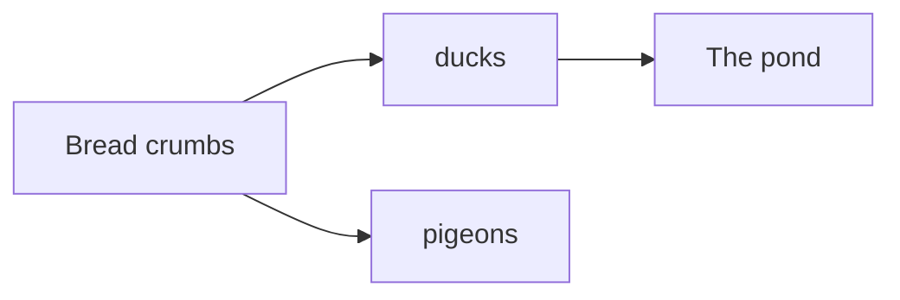
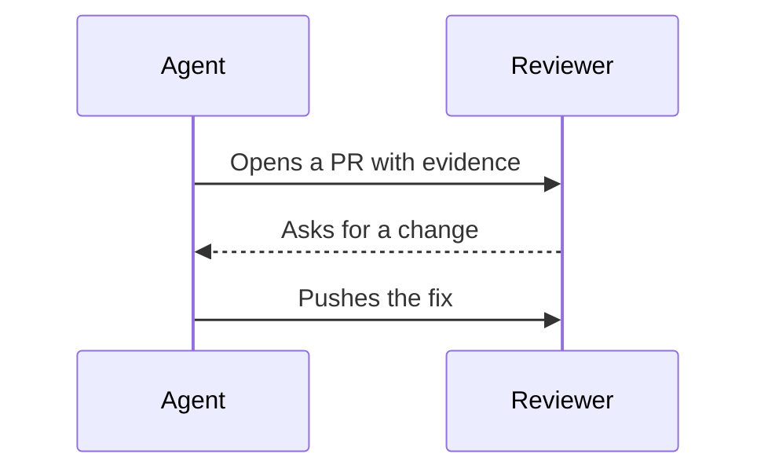
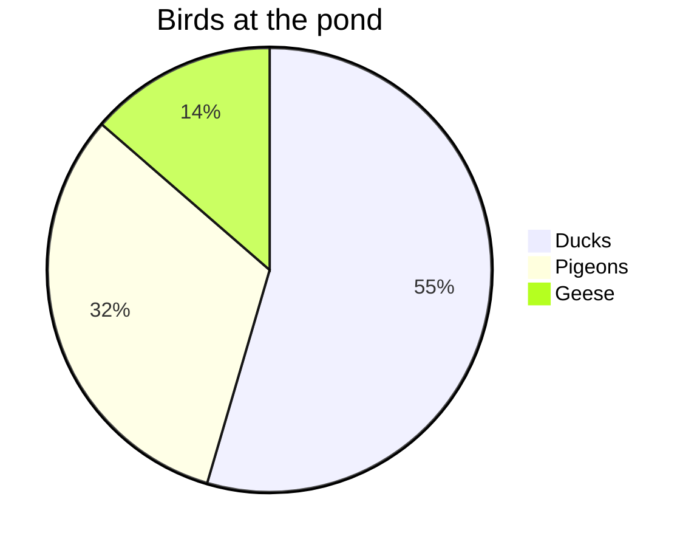
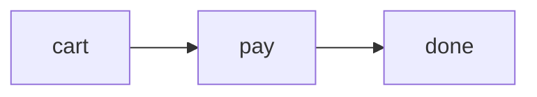

::examples
:::example{label="Flowchart"}
````md

````
:::

:::example{label="Sequence"}
````md

````
:::

:::example{label="Pie"}
````md

````
:::
::

## Features

- Mermaid is the syntax agents and GitHub already write, and it shows a flow or a schema faster than prose.
- [comark-pele](https://github.com/farnabaz/comark-pele) turns each `mermaid` fence into SVG with [Pele](https://pele.run), a Mermaid renderer with no dependencies.
- The page needs no script, and the diagram's source never leaves your machine.
- Through comark-ui, the diagrams follow the [shared tokens](/guide/theming/), so they match the other blocks in light and dark.
- comark-pele is a third-party plugin, by [farnabaz](https://github.com/farnabaz), not one of this repository's packages. [comark-ui](/getting-started/) registers it for you.

## Usage

Write a diagram in a ` ```mermaid ` or ` ```pele ` fence. Every other fence stays code.

::example
````md

````
::

### Diagram type

Use the diagram's first word to pick its type, as in Mermaid. Pele draws every diagram type built into Mermaid 12.1.0.

| First word | Diagram |
| --- | --- |
| `flowchart` or `graph` | Boxes and arrows |
| `sequenceDiagram` | Messages between participants |
| `classDiagram` | Classes and their relations |
| `stateDiagram` or `stateDiagram-v2` | States and transitions |
| `erDiagram` | Entities and relationships |
| `gantt` | Tasks on a timeline |
| `pie` | Shares of a whole |
| `xychart` or `xychart-beta` | Bars and lines on axes |
| `quadrantChart` | Points in four quadrants |
| `mindmap` | A tree of ideas |
| `timeline` | Events by period |
| `gitGraph` | Branches and commits |
| `journey` | Steps of a user journey, scored |
| `kanban` | Cards in columns |
| `block`, `packet`, `architecture-beta`, `requirementDiagram`, `C4Context`, `sankey`, `radar-beta`, `treemap`, and the newer `-beta` types such as `venn-beta` | As in Mermaid |

Mermaid settings, such as a diagram's own theme, go in the diagram, in its frontmatter or a `%%{init}%%` directive.

### Class and id

Use props after the language to put a class or an id on the diagram's wrapper, so it reaches your styles and links.

````md

````

## Examples

### Only `mermaid` fences

Pass `languages` to change which fences become diagrams:

```ts
pele({ languages: ["mermaid"] }); // only `mermaid` fences, not `pele` ones
```

### Check a diagram before you publish

A diagram Pele can't draw shows its source as code, with Pele's error in the wrapper's `data-error` attribute. Nothing goes in `meta.issues`, so check a diagram in the [playground](/play/#preset=mermaid-flowchart) before you publish it.

### Comark's own mermaid plugin

Comark has a built-in `mermaid` plugin too, which reads the same fences. Register only one of them for `mermaid` fences, or give comark-pele its own language with `pele({ languages: ["pele"] })`.

## API

### Options

In `comarkUi()`, the `mermaid` option takes comark-pele's options, or `false` to leave `mermaid` fences as code. [Getting started](/getting-started/#mermaid) says when turning it off is worth it.

| Option | Default | Description |
| --- | --- | --- |
| `languages` | `["mermaid", "pele"]` | The fence languages that become diagrams. |

### Issues

comark-pele adds nothing to `meta.issues`. A diagram that fails shows its source, with the error in `data-error`.

### Package

comark-ui brings `comark-pele` and registers it. To use it alone, install it:

```sh
pnpm add comark @comark/html comark-pele
```

Register its plugin and pass its `Pele` component:

```ts
import { createHtmlRenderer } from "@comark/html";
import pele, { Pele } from "comark-pele/html";

const render = createHtmlRenderer({ plugins: [pele()], components: { Pele } });
```

The HTML renderer puts static SVG in the page, so it needs no script, no browser, and no network, in Node or in a Cloudflare Worker. For Vue, React, or Svelte, import from `comark-pele/vue`, `comark-pele/react`, or `comark-pele/svelte`, or from comark-ui's entry for that renderer. Those components draw the same SVG on the server, then switch to Pele's `mount()` in the browser, which fits each diagram to its container and adds zoom.

On its own, comark-pele draws with Pele's colors. To put its diagrams on the `--comark-*` tokens, as comark-ui does, add `mermaidCss` from `comark-ui/client` to the page; [Theme](#theme) lists what it sets. [Renderers](/guide/renderers/) covers using it with other plugins.

## Theme

Through [comark-ui](/getting-started/), each diagram sits on a card in a 1px frame, and Pele paints it with the page's colors, so it follows light and dark like the other blocks without being drawn again. The rules sit in a `comark` CSS layer, so any plain rule of your own wins. comark-pele alone draws with Pele's own colors; add `mermaidCss` from `comark-ui/client` to the page for these.

### Shared tokens

| Token | Used for |
| --- | --- |
| `--comark-background` | The card and the diagram's background |
| `--comark-foreground` | Text and node labels |
| `--comark-muted` | Lines, arrows, and secondary text |
| `--comark-accent` | Node fills |
| `--comark-border` | Node borders and the card's frame |
| `--comark-radius` | The card's corners, and a little less on nodes |
| `--comark-font` | Every label |

Pie and xy charts color their series with `--comark-chart-1` to `--comark-chart-8`, then shadcn's `--chart-*`, like [charts](/charts/#theme).

### Variables

Pele paints with its `--pele-*` variables, which comark-ui sets on `:root` from the tokens. Set one on `.pele-diagram` to change a single color, such as `--pele-accent` for highlighted nodes. [Pele's theming](https://pele.run/theming) lists them all.

### Classes and attributes

| Selector | Is |
| --- | --- |
| `div.pele-diagram` | A diagram, with `data-diagram` set to its type, such as `flowchart` or `pie` |
| `svg.pele` | The drawing |
| `.pele-diagram[data-error]` | A diagram that failed |
| `pre.pele-source` | A failed diagram's source |
