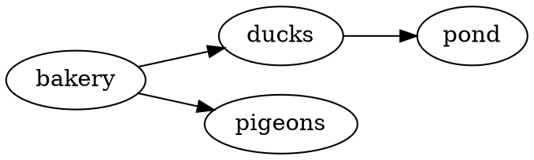
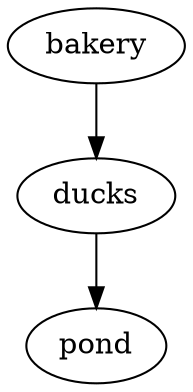

::examples
:::example{label="D2"}
````md
```d2 [How a sighting reaches the map]
phone -> api: POST /sightings
api -> queue: dedupe
queue -> map: pigeon pin
```
````
:::

:::example{label="Graphviz"}
````md

````
:::

:::example{label="ASCII"}
````md
```svgbob
  .-------.     .--------.
  | ducks |---->| census |
  '-------'     '--------'
```
````
:::
::

## Features

- PlantUML, Graphviz, D2, DBML, GoAT, and Svgbob fences become SVG in the page.
- A [Kroki](https://kroki.io) server draws each diagram while parsing, so the page needs no script.
- The plugin takes out anything in the SVG that could run.
- Each diagram sits on a white card, since the tools draw dark lines on white.
- A title names the diagram for screen readers.

> [!WARNING]
> The diagram's source leaves your machine. It goes to `kroki.io` unless you [run your own Kroki](#run-your-own-kroki).

## Usage

Write a diagram in a fence with its tool's language. Every other fence stays code.

::example
````md

````
::

### Languages

Use the fence's language to pick the tool that draws it.

| Fence | Drawn by |
| --- | --- |
| ` ```plantuml ` | [PlantUML](https://plantuml.com): sequence, class, state, and other UML diagrams |
| ` ```graphviz ` or ` ```dot ` | [Graphviz](https://graphviz.org): graphs in the DOT language |
| ` ```d2 ` | [D2](https://d2lang.com): boxes and arrows in a short syntax |
| ` ```dbml ` | [DBML](https://dbml.dbdiagram.io): database tables and their relations |
| ` ```goat ` | [GoAT](https://github.com/blampe/goat): ASCII art as lines and arrows |
| ` ```svgbob ` | [Svgbob](https://github.com/ivanceras/svgbob): ASCII art as lines and arrows |

### Title

Use a title in brackets after the language to put a caption under the diagram. It also names the diagram for screen readers.

::example
````md
```d2 [Login flow]
user -> api -> db
```
````
::

## Examples

### Where the source goes

Each diagram's source goes to the Kroki server in a POST request while the document is parsed. With the default `server`, that's `https://kroki.io`, a free public service run by the Kroki project. Don't send it a diagram you wouldn't post publicly: an internal architecture, a schema with sensitive names, anything under an NDA.

The readers of the page never contact Kroki. They get the SVG inline.

### Run your own Kroki

Kroki is open source and runs from one container. The core image draws Graphviz, PlantUML, D2, DBML, GoAT, and Svgbob:

```sh
docker run -d -p 8000:8000 yuzutech/kroki
```

Then point the plugin at it:

```ts
diagrams({ server: "http://localhost:8000" });
```

In CI, run it as a service container next to the build. See [Kroki's install guide](https://docs.kroki.io/kroki/setup/install/) for other options.

### Leave diagrams as code

Pass `draw: false` to leave every diagram as code and send nothing, such as in a linter.

```ts
diagrams({ draw: false });
```

### Diagrams on a dark page

The tools draw dark lines on white, so each diagram sits on a white card on any page, in its own frame. Set `--cdg-canvas` to change it, as [Theme](#theme) shows. A diagram wider than its card shrinks to fit it.

### Styles from the SVG

Some tools, such as D2, put a `<style>` in their SVG, scoped to the drawing's own ids. Inline SVG shares the page's styles, so the plugin keeps those and only drops `@import`. Theming the diagram itself is up to the tool's own syntax.

### What's kept from the SVG

The plugin keeps the drawing and drops what could run: scripts, event handlers such as `onclick`, embedded HTML (`foreignObject`), animations, links that aren't to a web page or within the drawing, and `@import` in its styles. The XML prolog, doctype, and comments go too.

## API

### Options

Options go under `diagrams` in `comarkUi()`, or to `diagrams()` when you use it alone.

| Option | Default | Description |
| --- | --- | --- |
| `server` | `"https://kroki.io"` | The Kroki server that draws the diagrams. Set your own to keep the sources private. |
| `draw` | `true` | `false` leaves every diagram as code and sends nothing. |

Parsing waits for each diagram from the Kroki server, so the page needs no script and no request when it's read. Every diagram is drawn once per process, so a site that builds many pages asks for each one once.

### Issues

A diagram Kroki can't draw stays as code, and the plugin adds a sentence to `meta.issues`, as [Validation](/guide/validation/) describes, with the first two lines of the tool's error. So does a diagram drawn while the server can't be reached:

```txt
The ```dot fence 2: Kroki couldn't draw it: Error: <stdin>: syntax error in line 1 near 'a'. Fix the diagram's source.
The ```d2 fence 1: couldn't reach the Kroki server at https://kroki.io (fetch failed). Check `server`, or build again.
```

A diagram that failed is drawn again on the next parse. Each issue has its own rule in [Doctor](/doctor/).

### Package

[comark-ui](/getting-started/) brings `comark-diagrams` and registers it. To use it alone, install it and pass the renderer's `components`:

```sh
pnpm add comark @comark/html comark-diagrams
```

```ts
import { createHtmlRenderer } from "@comark/html";
import diagrams, { components } from "comark-diagrams/html";

const render = createHtmlRenderer({ plugins: [diagrams()], components });
```

For Vue, React, or Svelte, import from `comark-diagrams/vue`, `comark-diagrams/react`, or `comark-diagrams/svelte`. The components add the styles when they mount. Import `comark-diagrams/style.css` with your styles so a server-rendered page doesn't shift. [Renderers](/guide/renderers/) covers using it with other plugins.

## Theme

Each diagram sits on a card in a 1px frame with its title under it. The card stays white on a dark page, since diagram tools draw dark lines on white whatever the page's theme. The rules sit in a `comark` CSS layer, so any plain rule of your own wins.

### Shared tokens

| Token | Used for |
| --- | --- |
| `--comark-muted` | The title under a diagram |
| `--comark-border` | The card's frame |
| `--comark-radius` | The card's corners |
| `--comark-font` | The title |

### Variables

| Variable | Default | Used for |
| --- | --- | --- |
| `--cdg-canvas` | `#fff` | The card behind a diagram. Set it on `.cdg` for a tool whose theme draws light lines. |

### Classes

| Selector | Is |
| --- | --- |
| `figure.cdg` | A diagram, with `data-type` set to its Kroki type, such as `d2` or `graphviz` |
| `.cdg-svg` | The card that holds the drawing |
| `.cdg figcaption` | The title |
