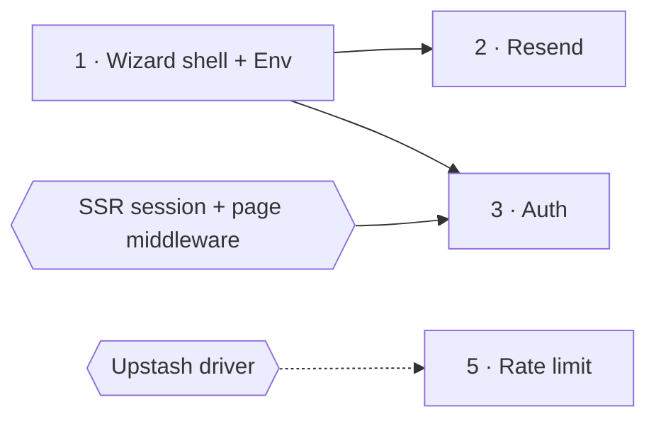

# Blocks for a report

Each block below renders with the full `comark-ui` preset. The `comark-ui` skill documents every block in full; read its reference for a block before you change more than the values here.

## The answer: callouts

```md
> [!IMPORTANT]
> **Your calls:**
>
> 1. Hold `@nuxtjs/i18n` until #3564 has URL routing?
> 2. Ship the Env and Resend codemods before Auth's SSR gap closes?

> [!WARNING]
> Every row needs Nuxt 5, and the codemods don't upgrade Nuxt.
```

Frontmatter `status`, `date`, and `tags` render as a properties box at the top with no extra markup.

## Bubble chart: two scores and a size

````md
::chart{title="Shortlist: value and difficulty (1 to 5), bubble size = npm downloads a week"}
| module | difficulty | value | downloads |
| --- | --: | --: | --: |
| nuxt-auth-utils | 4 | 5 | 177926 |
| Resend | 2 | 4 | 1251 |
| t3-env | 2 | 3 | 6072 |
| nuxt-cron | 2 | 3 | 3123 |

```vega-lite
{
  "width": 620,
  "height": 320,
  "encoding": {
    "x": { "field": "difficulty", "type": "quantitative", "scale": { "domain": [1.5, 5] }, "title": "Difficulty (5 = hardest)" },
    "y": { "field": "value", "type": "quantitative", "scale": { "domain": [2.5, 5.5] }, "title": "Value (5 = most)" }
  },
  "layer": [
    {
      "mark": { "type": "circle", "opacity": 0.55 },
      "encoding": { "size": { "field": "downloads", "type": "quantitative", "scale": { "range": [80, 3000] }, "legend": null } }
    },
    {
      "transform": [{ "filter": "indexof(['Resend', 't3-env', 'nuxt-cron'], datum.module) < 0" }],
      "mark": { "type": "text", "dy": -26, "fontSize": 12 },
      "encoding": { "text": { "field": "module" } }
    },
    {
      "transform": [{ "filter": "indexof(['Resend', 't3-env'], datum.module) >= 0" }],
      "mark": { "type": "text", "align": "right", "dx": -12, "fontSize": 12 },
      "encoding": { "text": { "field": "module" } }
    },
    {
      "transform": [{ "filter": "datum.module === 'nuxt-cron'" }],
      "mark": { "type": "text", "dy": 16, "fontSize": 12 },
      "encoding": { "text": { "field": "module" } }
    }
  ]
}
```
::
````

- With a `vega-lite` spec, `::chart` takes only `title`; `type`, `x`, and `y` are lint errors. Name the columns in `encoding`.
- Set `width` in pixels. `"container"` renders about 230px wide.
- Labels overlap when two points share a spot or sit close. Give each label layer a `filter` and move those points' labels left (`align: right`, `dx: -12`) or below (`dy: 16`). Look at the render; the lint can't see overlap.
- Write a range such as 4–5 as its middle, 4.5, and say so in the item's detail.

## Bar chart: sizes, with one mark

```md
::chart{type="bar" horizontal labels title="Left out: npm downloads a week (10k and up)"}
| module | downloads |
| --- | --: |
| @nuxtjs/i18n | 977490 |
| nuxt-csurf | 223523 |
:::annotation{at="@nuxtjs/i18n" mark="box" color="amber" side="right"}
Your call: hold until #3564 has URL routing.
:::
::
```

Rows draw in table order, so sort them largest first. Mark the bar a decision is about, at most one; a chart no decision points at gets no mark.

For sizes that split into parts, use `type="stacked"`, one column per part:

```md
::chart{type="stacked" horizontal title="Description characters per skill"}
| skill | sentence | trigger list |
| --- | --: | --: |
| emil-mobile-native | 760 | 551 |
| emil-prep-for-prod | 865 | 386 |
::
```

Each chart scales its own axis. When two charts compare the same unit, put the rows in one chart, or write both in `vega-lite` with the same `"scale": { "domain": [0, 1400] }` on the value axis, so equal values draw equal bars.

## Order and blockers: a flowchart

````md

````

Use `LR` for up to about five steps side by side and `TB` for a longer chain or long labels; the diagram scales down to fit the page width, so a wide one renders small. Boxes are steps, numbered in the order the reader acts. Hexagons are work that has to land first; a dashed arrow means it should land first but doesn't have to. Say both in the sentence above the diagram.

## The decision table: past three decisions

```md
| # | Decision | Opus | Sol | Recommend |
| --- | --- | --- | --- | --- |
| D1 | Import family for apps | `vite-hub/*` | `@vite-hub/*` | :badge[vite-hub/*]{color="success"} |
| D2 | Sandbox Task option key | `sandboxTask` | `sandbox.tasks` | :badge[sandboxTask]{color="success"} |
```

Each cell is the position, not the argument. The arguments go in the decision's accordion item, labeled with its number.

## The table: at most five columns

```md
| Step | Module → primitive | npm/week | Fit |
| --- | --- | --: | --- |
| 1 | `@t3-oss/env-nuxt` → Env | 6,072 | :badge[High]{color="success"} |
| 3 | `nuxt-auth-utils` → Auth | 177,926 | :badge[Partial]{color="warning"} |
```

Badge colors: `success` good, `warning` partial or at risk, `error` blocked, `neutral` unknown. Scores that are already in a chart stay out of the table. A cell holds a value, a badge, or a few words; a column of sentences turns the table into a wall of text, so move it into the accordion.

Write file names and domains in backticks, such as `AGENTS.md` and `devtools.fm`. Bare, they render as link chips with an icon.

## Each item: an accordion

````md
::accordion
:::accordion-item{label="2 · Resend → Email"}
| Resend | ViteHub Email |
| --- | --- |
| `new Resend(key).emails.send(msg)` | `email.send(msg)` |

- **Manual:** batch, contacts, audiences, broadcasts.
- **First:** nothing.
- **Gain:** a dev outbox and Console preview.
:::
::
````

Every item has the same parts in the same order, with bold labels, a line or two each. A part that needs more becomes a table inside the item. The label starts with the item's step number from the table. Icons come from `lucide:`; pick one per kind of item.

## Before and after: stats and delta

```md
::stats{better="lower"}
| Measure | Before | After |
| --- | --: | --: |
| Description characters loaded | 23,515 | 10,981 |
| Model-invoked skills | 49 | 41 |
::

Trimming the lists saves :delta{from=23515 to=10981 unit="chars" better="lower"} every session.
```

`::stats` holds one table of exactly three columns: a name, before, after. Each cell is a number with an optional unit, the same unit in both cells, and the block adds the percent itself. A value with a qualifier, such as "about 65" or "6 of 11", belongs in a plain table, or keeps its number in the cell and moves the qualifier into the row's name. `better` applies to every row, so rows that are better higher go in a second block.

## A share: progress

```md
:progress{value=293 max=785 label="nuxt-security configs that mention rateLimiter"}
```

## How I checked

````md
> [!CAUTION]
> **Not verified:** any source module on Nuxt 5; the Docus count (one npm call).

::details{summary="Sources and method"}
- **Downloads:** `api.npmjs.org/downloads/point/last-week`, 2026-10-30 to 2026-11-05.
::
````

## Render it locally

A host renders the report only after you publish it, and a private page may need the user's sign-in, so check the render before you hand it over. Copy this skill's [scripts/render.mjs](../scripts/render.mjs) next to the report, then:

```sh
mkdir -p tmp/report-render && cd tmp/report-render
echo '{ "private": true, "type": "module" }' > package.json
pnpm add --ignore-workspace comark @comark/html comark-ui playwright
node ../render.mjs ../report.md out
```

Without its own `package.json`, pnpm walks up to the repository's and can fail on its catalog. The script writes `out/report.html` and screenshots at 900px wide, 1600px tall each: `report-closed-*.png` as the reader first sees it, and `report-open-*.png` with every fold open. When Playwright has no browser downloaded, it uses the newest Chromium in `~/.cache/ms-playwright`.
