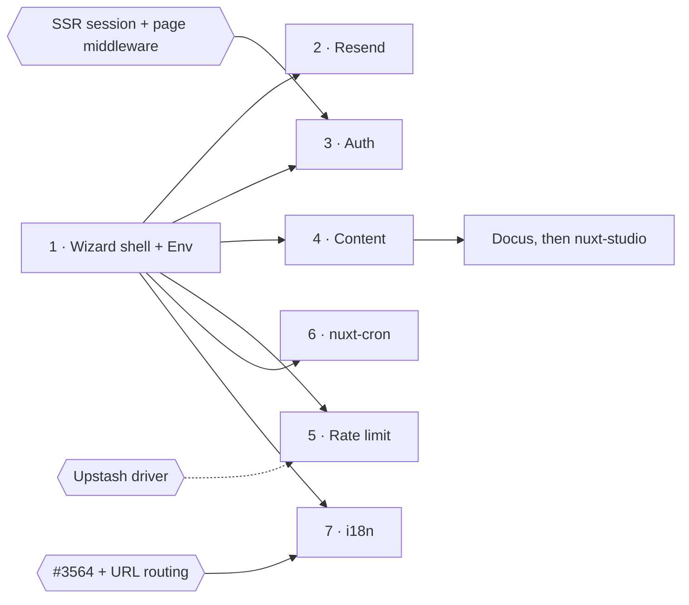

## The answer

Build the wizard shell with the Env codemod, then add Resend, Auth and Content. Auth and Content hold most of the users, but each needs ViteHub work first. Env and Resend are cheap and prove the wizard end to end.

> [!IMPORTANT]
> **Your call:** hold `@nuxtjs/i18n`, the largest audience at 977k a week, until #3564 merges and i18n has URL routing?

> [!WARNING]
> Every row needs Nuxt 5. Most source apps run Nuxt 4 and the codemods don't upgrade Nuxt, so the wizard checks the version first.

## Value against cost

Up and to the right is worth more and costs more. Bubble size is weekly npm downloads. Auth and Content are the two big bubbles. The cheap wins sit at difficulty 2.

::chart{title="Shortlist: value and difficulty (1 to 5), bubble size = npm downloads a week"}
| module | difficulty | value | downloads |
| --- | --: | --: | --: |
| nuxt-auth-utils | 4 | 5 | 177926 |
| @nuxt/content | 4 | 4 | 240394 |
| Docus | 3 | 4 | 15800 |
| Resend | 2 | 4 | 1251 |
| nuxt-security limiter | 3 | 3 | 220740 |
| t3-env | 2 | 3 | 6072 |
| sidebase | 4.5 | 3 | 46448 |
| nuxt-cron | 2 | 3 | 3123 |

```vega-lite
{
  "width": 620,
  "height": 320,
  "encoding": {
    "x": { "field": "difficulty", "type": "quantitative", "scale": { "domain": [1.5, 5] }, "title": "Difficulty (5 = hardest)" },
    "y": { "field": "value", "type": "quantitative", "scale": { "domain": [2.5, 5.5] }, "title": "Value (5 = most)" }
  },
  "layer": [
    {
      "mark": { "type": "circle", "opacity": 0.55 },
      "encoding": { "size": { "field": "downloads", "type": "quantitative", "scale": { "range": [80, 3000] }, "legend": null } }
    },
    {
      "transform": [{ "filter": "indexof(['t3-env', 'Docus', 'Resend'], datum.module) < 0 && datum.module !== 'nuxt-cron'" }],
      "mark": { "type": "text", "dy": -26, "fontSize": 12 },
      "encoding": { "text": { "field": "module" } }
    },
    {
      "transform": [{ "filter": "indexof(['t3-env', 'Docus', 'Resend'], datum.module) >= 0" }],
      "mark": { "type": "text", "align": "right", "dx": -12, "fontSize": 12 },
      "encoding": { "text": { "field": "module" } }
    },
    {
      "transform": [{ "filter": "datum.module === 'nuxt-cron'" }],
      "mark": { "type": "text", "dy": 16, "fontSize": 12 },
      "encoding": { "text": { "field": "module" } }
    }
  ]
}
```
::

## The order

Boxes are codemods, numbered in build order. Hexagons are ViteHub work that has to land first; a dashed arrow means it should land first but doesn't have to.



| Step | Module → primitive | npm/week | Fit |
| --- | --- | --: | --- |
| 1 | `@t3-oss/env-nuxt` → Env | 6,072 | :badge[High]{color="success"} |
| 2 | `resend`, `nuxt-resend` → Email | 1,251 | :badge[High]{color="success"} |
| 3 | `nuxt-auth-utils` → Auth | 177,926 | :badge[Partial]{color="warning"} |
| 3 | `@sidebase/nuxt-auth` → Auth | 46,448 | :badge[Partial]{color="warning"} |
| 4 | `@nuxt/content` v3 → Content | 240,394 | :badge[Partial]{color="warning"} |
| 4 | Docus → `@vite-hub/docs` | ~15,800 | :badge[High]{color="success"} |
| 5 | `nuxt-security` limiter → Rate Limit | 220,740 | :badge[Partial]{color="warning"} |
| 6 | `nuxt-cron` → Schedule | 3,123 | :badge[High]{color="success"} |

Resend's count is `nuxt-resend` alone; 274 more apps call `resend` directly from server routes. Inside step 3, `@nuxtjs/better-auth` (2,101 a week) goes first: it runs Better Auth on both sides, so users, hashes and sessions keep their format.

## What ViteHub has to add

Each gap below blocks a codemod or a group of users. i18n routing unblocks the most by far.

::chart{type="bar" horizontal labels title="npm downloads a week each missing feature would unblock"}
| Missing in ViteHub | downloads |
| --- | --: |
| i18n: URL routing | 985785 |
| Auth: SSR session + page middleware | 226475 |
| MCP: app-level server | 42096 |
| Email: SMTP driver | 4620 |
| Rate Limit: Upstash driver | 2044 |
::

::details{summary="Which modules each gap unblocks"}
| Gap | Unblocks |
| --- | --- |
| i18n: URL routing | `@nuxtjs/i18n` 977,490, `nuxt-i18n-micro` 8,295 |
| Auth: SSR session + page middleware | `nuxt-auth-utils` 177,926, sidebase 46,448, `@nuxtjs/better-auth` 2,101 |
| MCP: app-level server | `@nuxtjs/mcp-toolkit` 42,096 |
| Email: SMTP driver | `nuxt-nodemailer` 3,376, `nuxt-mail` 1,244, plus 609 apps on raw `nodemailer` |
| Rate Limit: Upstash driver, windows past 10s and 1m on Cloudflare | `nuxt-api-shield` 2,044, `@upstash/ratelimit`, and the nuxt-security default of 5 minutes on Cloudflare |
::

## Each codemod

Every item has the same three parts: what the codemod rewrites, what stays manual, and what has to land first.

::accordion
:::accordion-item{label="1 · @t3-oss/env-nuxt → Env"}
| t3-env | ViteHub Env |
| --- | --- |
| `createEnv({ server, client })` | the existing converter in `nuxt-safe-runtime-config/schema.ts`, as it is |

- **Manual:** nothing found.
- **Bonus:** `@arkenv/nuxt` (202 a week) comes almost free, since the converter already reads ArkType.
:::

:::accordion-item{label="2 · Resend → Email"}
| Resend | ViteHub Email |
| --- | --- |
| `new Resend(key).emails.send(msg)`, `useResend()` | `email.send(msg)`, same message fields |
| `const { data, error }` | `const [error, data]` |
| (nothing) | `vitehub.email = { driver: 'resend', options: { apiKey: env(...) } }` |

- **Manual:** batch, contacts, audiences, broadcasts, `react` payloads, Resend templates.
- **Gain:** a dev outbox, Console preview, a path to Cloudflare Email.
- **The wizard's report must say:** in dev, sends go to the outbox unless `remote: true`.
:::

:::accordion-item{label="3 · nuxt-auth-utils → Auth"}
| nuxt-auth-utils | ViteHub Auth |
| --- | --- |
| `'nuxt-auth-utils'` in `modules` | `'vite-hub/nuxt'` |
| `runtimeConfig.oauth.<p>`, `NUXT_OAUTH_<P>_*` | `socialProviders.<p>` in `server/auth.ts`, with Env |
| `useUserSession()` `fetch`, `clear` | `refresh`, `signOut` (`loggedIn`, `user`, `ready` match) |
| `/auth/github` links | `signIn.social({ provider: 'github' })` |
| `getUserSession`, `requireUserSession` | `auth.api.getSession`, `withAuth` |

- **Providers:** about 25 of 52 are in Better Auth core; auth0, keycloak, okta and others go through `genericOAuth`; six, such as steam, mastodon and atproto, have no equivalent.
- **Manual:** `onSuccess` upserts move to `databaseHooks`; custom `setUserSession` data; user shape and IDs change (`user.login` breaks); everyone signs in again and each provider needs the `/api/auth/callback/<p>` URL; Adonis scrypt hashes need a custom `password.verify`; WebAuthn moves to the passkey table.
- **First:** a server-rendered session (`useUserSession()` stays pending during SSR, `packages/auth/README.md:317`) and page middleware. Without them the migrated app flashes signed-out on every load.
- **Gain:** a real users store, the Console, Auth events, admin, 2FA and organizations.
:::

:::accordion-item{label="3 · @sidebase/nuxt-auth → Auth"}
| sidebase (authjs) | ViteHub Auth |
| --- | --- |
| `NuxtAuthHandler({ providers })` | `socialProviders` |
| `useAuth()`, `status === 'authenticated'` | `useUserSession()`, `loggedIn` |
| `getServerSession` | `auth.api.getSession` |

- **Refuse:** the `local` provider, which sends bearer tokens to an external backend.
- **Manual:** the `jwt` and `session` callbacks.
:::

:::accordion-item{label="4 · @nuxt/content v3 → Content"}
| @nuxt/content | ViteHub Content |
| --- | --- |
| `content.config.ts` `defineCollection({ source })` | `server/content.ts` `defineContent({ sources })` with `glob()` |
| `queryCollection(c).path(p).first()` | `content.get(p)` |
| `queryCollectionNavigation` | `content.navigation` |
| `<ContentRenderer>`, `<MDC>` | `<Markdown>` |

- **Manual, reported with `file:line`:** every `.where/.order/.limit/.select/.count` chain (no query builder), the `database` adapters, remote `repository` sources, `queryCollectionItemSurroundings`.
- **Gain:** drafts and publishing, Console editing, Agent access, no SQL dump at build.
- **Won't move:** apps that query content heavily.
:::

:::accordion-item{label="4 · Docus → @vite-hub/docs"}
| Docus | @vite-hub/docs |
| --- | --- |
| `extends: ['docus']` + `app.config.ts` `seo`, `header`, `github`, `socials` | `modules: ['@vite-hub/docs/nuxt']` with `docs: { site, github, socials }` |
| `content/**` | `content/docs/<section>/` |
| `AppHeader`, `DocsAsideLeftTop` overrides | same names |

- **Manual:** Docus i18n, which has no target.
- **Not verified:** a Comark UI equivalent for every Nuxt UI prose component.
- **Why it ranks high:** the whole site moves, vitehub.dev is the oracle, and it reuses the Content codemod.
:::

:::accordion-item{label="5 · nuxt-security limiter → Rate Limit"}
:progress{value=293 max=785 label="nuxt-security configs that mention rateLimiter"}

The limiter is on by default: 150 requests per 300,000 ms per IP and route.

| nuxt-security | ViteHub Rate Limit |
| --- | --- |
| `security.rateLimiter` | `false`; the module stays for headers and CSP |
| (nothing) | `server/middleware/rate-limit.ts` with `requireRateLimit()`, `vitehub.rateLimit: true` |

- **Manual:** per-route `routeRules` overrides, `whiteList`, `ipHeader`, Redis storage.
- **Wall:** only memory and Cloudflare drivers, and Cloudflare allows only 10s or 1m windows, so the module's 5m default fails the build there.
:::

:::accordion-item{label="6 · nuxt-cron → Schedule"}
| nuxt-cron | ViteHub Schedule |
| --- | --- |
| `server/cron/<n>.ts` `defineCronHandler(time, cb)` | `server/schedules/<n>.ts` `defineSchedule({ cron, handler })` |
| presets | 5-field cron |

- **Manual:** `everySecond`, `timeZone`.
- **Gain:** a node-only cron runs on Cloudflare, Vercel and Netlify, with run history.
:::
::

## Left out

The chart shows what we leave on the table, 10k a week and up. i18n is the one big loss. The rest have no ViteHub target or wait on a codemod above.

::chart{type="bar" horizontal labels title="Left out: npm downloads a week (10k and up)"}
| module | downloads |
| --- | --: |
| @nuxtjs/i18n | 977490 |
| nuxt-csurf | 223523 |
| @nuxtjs/supabase | 94526 |
| @nuxtjs/turnstile | 46735 |
| @nuxtjs/mcp-toolkit | 42096 |
| @clerk/nuxt | 40184 |
| nitro-cloudflare-dev | 29560 |
| nuxt-vuefire | 15428 |
| nuxt-studio | 14956 |
| nuxt-multi-cache | 14125 |
| nuxt-oidc-auth | 10859 |
:::annotation{at="@nuxtjs/i18n" mark="box" color="amber" side="right"}
Your call: hold until #3564 has URL routing.
:::
::

::accordion
:::accordion-item{label="Waits on ViteHub work (8)"}
| Module | npm/week | Waits on |
| --- | --: | --- |
| `@nuxtjs/i18n` | 977,490 | #3564 and URL routing (`useLocalePath`, `NuxtLinkLocale`, hreflang) |
| `nuxt-i18n-micro` | 8,295 | the same |
| `nuxt-studio` | 14,956 | the Content codemod |
| `nuxt-oidc-auth` | 10,859 | the Auth codemod; small audience, `h3` 1 |
| `nuxt-nodemailer`, `nuxt-mail` | 3,376 + 1,244 | an SMTP driver; the largest email segment |
| `nuxt-api-shield`, `@upstash/ratelimit` | 2,044 | an Upstash or Redis driver |
| `nitro-cloudflare-dev` | 29,560 | proof that ViteHub provides every binding in dev (only KV checked, #3480) |
| `nuxt-file-storage` | 845 | nothing; a cheap shim over `blob` after step 6 |
:::

:::accordion-item{label="No ViteHub primitive (5)"}
| Module | npm/week | Missing |
| --- | --: | --- |
| `nuxt-csurf` | 223,523 | CSRF |
| `@nuxtjs/turnstile` | 46,735 | captcha |
| `@nuxtjs/mcp-toolkit` | 42,096 | an app-level MCP server |
| `nuxt-multi-cache` | 14,125 | component and route caching, CDN tags |
| `nuxt-processor` (BullMQ) | 1,183 | priorities, repeats and flows in Queue |
:::

:::accordion-item{label="Data lives in a hosted service (4)"}
| Module | npm/week |
| --- | --: |
| `@nuxtjs/supabase` | 94,526 |
| `@clerk/nuxt` | 40,184 |
| `nuxt-vuefire` | 15,428 |
| Strapi, Sanity, Storyblok, Directus, Prismic | various |

Users, hashes and content stay in the service, so a codemod has nothing to move. At most a skeleton and a link to Better Auth's guide.
:::

:::accordion-item{label="Nothing worth a codemod (6)"}
| Module | Why |
| --- | --- |
| `nuxt-authorization` (7,188) | keep it; rewrite its two resolvers inside the Auth codemod |
| `nuxt-email-renderer` (5,291) | templates keep working through `email.send` |
| `@workflow/nuxt` (2.8M, transitive) | Workflow DevKit is already portable |
| `@prisma/nuxt` (896) | deprecated, and no Prisma support |
| Nitro `scheduledTasks` (294 configs) | Nitro 3 already runs them; a Vite Doctor hint fits better |
| Nitro `useStorage` with Redis (270 configs) | every call site changes and there's no ioredis driver; only `nitro.storage.cache` → `vitehub.cache` is cheap |
:::
::

## How I checked

> [!CAUTION]
> **Not verified:** any source module on Nuxt 5; sessions surviving the `@nuxtjs/better-auth` move; how many nuxt-security users want only the limiter; the Docus count (one npm call); Comark covering every MDC feature, such as named slots and `{{ $doc }}`.

::details{summary="Sources and method"}
- **The field:** all 334 modules in the `api.nuxt.com/modules` registry (2026-11-07), 375 npm search hits across 45 primitive terms, and about 120 named packages the registry misses, such as nuxt-auth-utils.
- **Downloads:** `api.npmjs.org/downloads/point/last-week`, 2026-10-30 to 2026-11-05.
- **Stars and last push:** the GitHub API.
- **Module APIs:** the npm tarballs. **ViteHub APIs:** `docs/content/docs/*` and the package READMEs on main (`c845af3ae`).
- **Code counts:** GitHub's legacy code search; rough and not limited to Nuxt.
::
