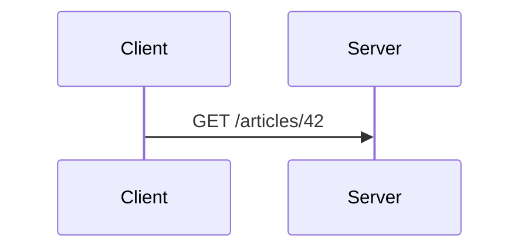
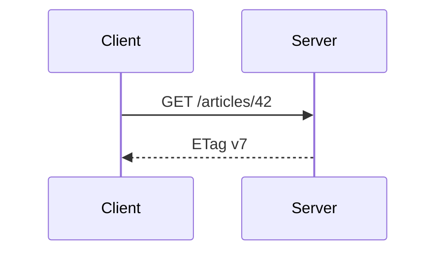

# Blocks for a lesson

These blocks come with `comark-ui`. The steps and questions also come separately with `comark-steps` and `comark-quiz`.

## The worked example: `::steps`

````md
::steps
### Both load version 7

Ana and Ben each `GET /articles/42`, and both get `ETag: "v7"`.

### Ana saves first

```http
PUT /articles/42
If-Match: "v7"
```
::
````

Each `###` heading starts a step that holds everything up to the next one, code blocks included. Put any introduction above the block; content before the first heading renders above the steps and is reported. For steps of one line each, a numbered list inside `::steps` works too.

## Build a diagram across steps

Use a `mermaid` fence when a diagram helps explain interacting parts. At each move, redraw the previous diagram with one more part or relationship, and keep its labels and participant order.

Use numbered Markdown headings for the worked example. Mermaid fences currently disappear inside `::steps`, so place them directly under these headings:

````md
### 1. The client requests the article



### 2. The server returns a version label


````

These paths and version labels are illustrative. Use `sequenceDiagram` for messages or `flowchart LR` for a flow.

## The check: `::question`

```md
::question{#etag-no-if-match}
Ben's editor sends his `PUT` with no `If-Match` header. What happens?

- [x] The server saves Ben's version and Ana's fix is lost
  > Without `If-Match` there's no condition to fail.
- [ ] The server refuses the save with a 412 status code
  > A 412 needs a condition that failed.

#hint
What does the server compare the label against?

#explain
`If-Match` is opt-in.
::
```

- Mark each right option `[x]`. One `[x]` makes radio buttons and several make checkboxes. Add `multiple` to show checkboxes even with one right option.
- The `>` quote under an option is its rationale, shown once the reader answers.
- `#hint` is optional and opens on request. `#explain` opens after the right answer or Show answer, not after a wrong pick.
- Options are shuffled the same way on every render. Write `shuffle="false"` only when their order means something, such as numbers in order.
- Give the block an `#id` so a host can store the answer. Without one, the id comes from the question's text and changes when you edit it.

Without its script, the question and an answer disclosure still render as plain HTML.

## The fact to keep: `::recall`

```md
::recall{#etag-412}
What does a server answer when `If-Match` names an old version?

#answer
`412 Precondition Failed`, and it leaves the resource unchanged.
::
```

The reader answers in their head, then reveals `#answer`.
