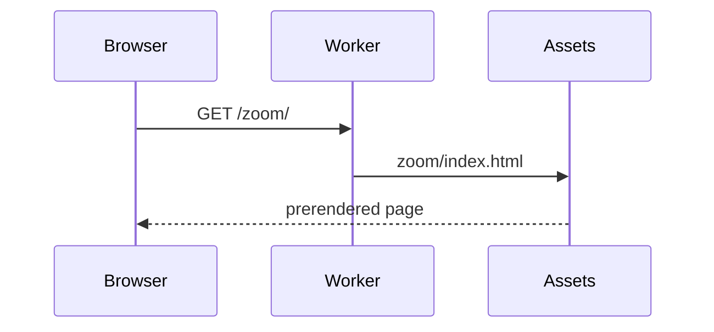

# Blocks for a visual explanation

These blocks come with `comark-ui`. The comark-ui skill (`vp dlx skills add onmax/comark-ui`) documents every block in full.

## Diagrams: a `mermaid` fence

````md

````

comark-ui draws Mermaid as SVG while parsing, so the page needs no script to show it. Use `flowchart LR` for a pipeline, `sequenceDiagram` for messages between parts, and `stateDiagram-v2` for states. Write labels as the code names them. For a diagram in another language, `d2`, `dot`, `plantuml`, `dbml`, `goat`, and `svgbob` fences draw through comark-diagrams.

## A call tree: a `text` fence

````md
```text
renderPage
  parseMarkdown
    plugins' post
  renderHtmlFromDocument
    components
```
````

Indent by call depth, two spaces a level. Name functions as the code does.

## Files: `::file-tree`

````md
::file-tree
```
docs/
  build.ts  # renders every page
  ~ style.css
  + pages/
    + skills/
...
```
::
````

Two spaces nest an entry, a trailing `/` makes a folder, `+`, `-`, and `~` mark added, removed, and changed, and ` # ` starts a note. `...` stands for entries left out. Write the tree in a fence; a Markdown list renders names like `__init__.py` as bold.

## Line notes: `// <1>` and a list

````md
```ts
const document = await parseMarkdown(source, { plugins }); // <1>
const html = await renderHtmlFromDocument(document, { components }); // <2>
```

1. Every plugin runs here.
2. Components only draw.
````

A numbered list right after the fence becomes the notes. The marker goes in a line-end comment in the block's language, such as `# <1>` in Python.

## On screen: `::screenshot`

```md
::screenshot{src="https://example.com/settings.png" alt="Settings page with the Save button" viewport="1280x800"}
:::annotation{x=71.2 y=84.1 w=12.4 h=6.3}
**Save** writes all three tabs at once.
:::
::
```

Measure `x y w h` from the page as percentages of the image. The before-after-evidence skill explains how.

## Numbers: `::chart`

```md
::chart{type="bar" title="Build time, seconds"}
| Step | Before | After |
| --- | --: | --: |
| Parse | 4.1 | 1.2 |
| Render | 2.3 | 2.2 |
::
```

The chart draws from the table, so the numbers in your text and the chart can't disagree.
