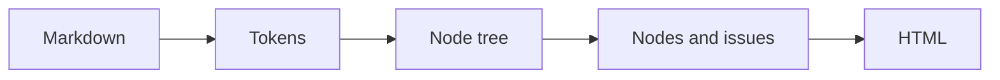

# How a Comark document becomes HTML

Parsing and rendering are two separate calls, and the plugins do their work in the first. That's why a block's problems are known before any HTML exists.



A plugin can join at three points: its Markdown rules while the text becomes tokens, `markdownItPost` on the tokens, and `post` on the tree. The last arrow is the renderer, which only maps each node to a component.

In code, the diagram is three lines:

```ts
const document = await parseMarkdown(source, { plugins }); // <1>
if (document.meta.issues.length) refuse(document.meta.issues); // <2>
const html = await renderHtmlFromDocument(document, { components }); // <3>
```

1. Every plugin runs here, in the order of `plugins`.
2. Each issue is one sentence naming the block and the fix, so a host can refuse a document before it renders.
3. Components only draw: `screenshot` maps to the figure's HTML, and nothing is parsed again.
